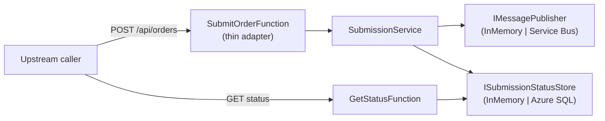

# 01 — Overview

## What this is

A reference implementation showing how to deliver **Azure Functions** features using
**Spec-Driven Development (SDD)**. Every feature is produced by running a repeatable loop that
turns a backlog ticket into a written spec, a plan, dependency-ordered tasks, and finally a tested
vertical slice — rather than ad-hoc prompting or undocumented code.

The worked example is an **asynchronous purchase-order submission** API:

- `POST /api/orders` validates an order, records an `Accepted` status, publishes one envelope to a
  submit transport, and returns `202 { correlationId }`.
- `GET /api/orders/{correlationId}/status` returns the latest known status.

## Guiding principles

1. **Spec-first.** No production code before a `spec.md` exists for the feature.
2. **Thin adapters, rich core.** Function triggers only bind, validate, dispatch, and return.
   All logic lives in `Services/` and `Models/`, which hold no Azure SDK references.
3. **Testable offline.** The test project runs with no Azure infrastructure.
4. **Traceable.** The originating JIRA/ADO ticket id is the correlation key across
   ticket → spec → branch → PR.
5. **Observable & secure by default.** Structured logging with a correlation id; Managed Identity
   for every PaaS-to-PaaS hop in production.

## Technology

- .NET 8 LTS, C# 12, Azure Functions isolated worker.
- FluentValidation for boundary validation.
- System.Text.Json for serialization.
- `TimeProvider` injected for time; no `DateTime.UtcNow`.
- xUnit + FluentAssertions for tests.

For production, the in-memory publisher and status store are swapped for Azure Service Bus and
Azure SQL (Dapper) — a dependency-injection change only. See
[ADR-0004](../adr/ADR-0004-in-memory-adapters-for-demo.md).

## High-level shape

