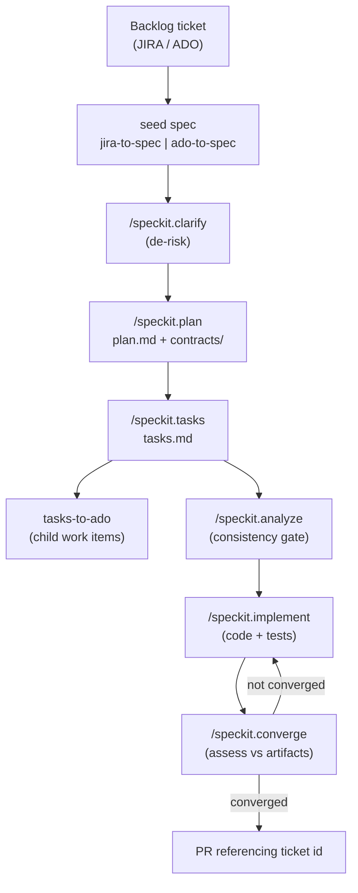

# 02 — SDD Workflow

Every feature follows the same loop. Each phase produces a Markdown artifact that feeds the next,
giving the AI agent structured context instead of ad-hoc prompts.



## Phases

| Phase | Command / prompt | Output |
|-------|------------------|--------|
| Constitution | `/speckit.constitution` | `.specify/memory/constitution.md` (once per project) |
| Seed (inbound) | `jira-to-spec` / `ado-to-spec` | `specs/<feature>/spec.md` from the ticket |
| Specify (net-new) | `/speckit.specify` | `specs/<feature>/spec.md` |
| Clarify | `/speckit.clarify` | updated `spec.md`, ambiguities resolved |
| Plan | `/speckit.plan` | `plan.md`, `contracts/`, `data-model.md` |
| Tasks | `/speckit.tasks` | `tasks.md` (dependency-ordered) |
| Link (outbound) | `tasks-to-ado` | child work items linked under the ticket |
| Analyze | `/speckit.analyze` | cross-artifact consistency report |
| Implement | `/speckit.implement` | the vertical slice + tests |
| Converge | `/speckit.converge` | gap assessment; repeat until Converged |

## Where the artifacts live

```
specs/001-order-submission/
├── spec.md               # what & why — every requirement testable
├── plan.md               # how — tech decisions, architecture
├── contracts/
│   └── orders-api.md      # request/response contract
└── tasks.md              # dependency-ordered, checklist format
```

## Rules

- Do not write production code before `spec.md` exists.
- Mark anything underspecified as `[NEEDS CLARIFICATION: …]` — never invent requirements.
- A vertical slice touches one Functions project, its test project, and optionally one contract and
  one DB migration. Wider changes are platform changes and need an ADR.
