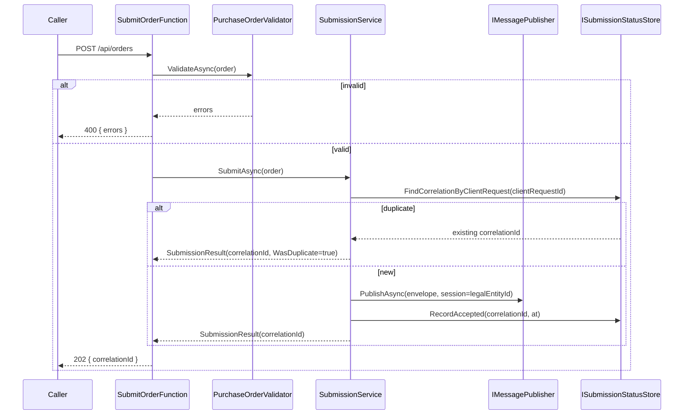
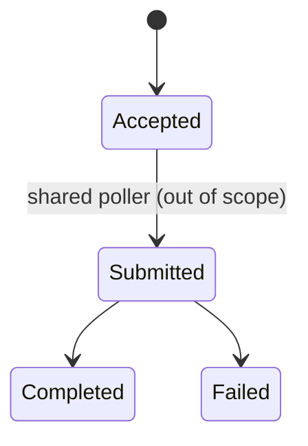

# 04 — Submission Pipeline

How an inbound purchase order flows through the system.

## Key behaviours

| Behaviour | Where | Requirement |
|-----------|-------|-------------|
| Boundary validation, nothing published on failure | `SubmitOrderFunction` + validator | FR-002 |
| Exactly one envelope, session = legal-entity id | `SubmissionService` | FR-003 |
| Initial `Accepted` status recorded | `SubmissionService` + store | FR-004 |
| Idempotency on `clientRequestId` | `SubmissionService` + store | FR-006 |
| Status read by correlation id, 404 if unknown | `GetStatusFunction` | FR-007 |
| Correlation id in every log scope | `SubmissionService` | FR-005 |

## Status lifecycle

This feature owns only the transition to **Accepted**. The downstream transitions
(`Submitted`/`Completed`/`Failed`) are written by shared infrastructure (a poller) and are out of
scope for this slice — see the spec's Assumptions.

## Production mapping

- `IMessagePublisher` → Azure Service Bus topic, session id = legal-entity id (ordered processing
  per entity).
- `ISubmissionStatusStore` → Azure SQL via Dapper (see [ADR-0003](../adr/ADR-0003-dapper-not-ef-core.md)).
- Every PaaS-to-PaaS hop uses Managed Identity; no secrets in code or config.
