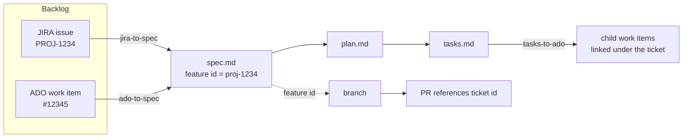

# 05 — Traceability (JIRA & Azure DevOps)

Requirements originate in **JIRA or Azure DevOps**. The originating **ticket id is the feature id**
and is the single correlation key across ticket → spec → branch → PR → work items.

## Inbound (ticket → spec)

| Source | Prompt | Access |
|--------|--------|--------|
| JIRA | [jira-to-spec.prompt.md](../../.github/prompts/jira-to-spec.prompt.md) | JIRA MCP server if configured, else JIRA REST API (`JIRA_BASE_URL`, `JIRA_EMAIL`, `JIRA_API_TOKEN` from env) |
| ADO | [ado-to-spec.prompt.md](../../.github/prompts/ado-to-spec.prompt.md) | Azure DevOps MCP tools (`wit_work_item`, `search_workitem`) |

Field mapping:

| Ticket field | Spec section |
|--------------|--------------|
| Title / Summary | Feature name |
| Description | Overview + user-story narrative |
| Acceptance Criteria | Acceptance Scenarios (Given/When/Then) + Functional Requirements |
| Child items / sub-tasks | Prioritised User Stories (P1/P2/P3) |
| Id + URL | `**Input**` line (explicit trace) |

Gaps are marked `[NEEDS CLARIFICATION: …]` — the agent never invents requirements.

## Outbound (tasks → work items)

[tasks-to-ado.prompt.md](../../.github/prompts/tasks-to-ado.prompt.md) turns `tasks.md` into an
ADO hierarchy: one Epic per spec, one Feature per user-story group, one Story per task, each tagged
with the feature id and linked under the originating ticket.

## Governance

- Inbound **enriches** the ticket — it never silently overwrites it.
- No ticket or work-item field is created or modified without **explicit human approval**.
- Secrets (JIRA token, etc.) are read from the environment only and never printed or committed.
- Every PR references its ticket id in the title or description.

See [ADR-0005](../adr/ADR-0005-ticket-id-as-feature-id.md) for the rationale.
